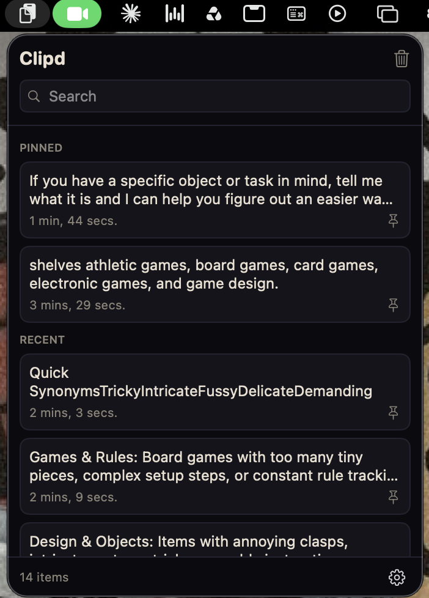
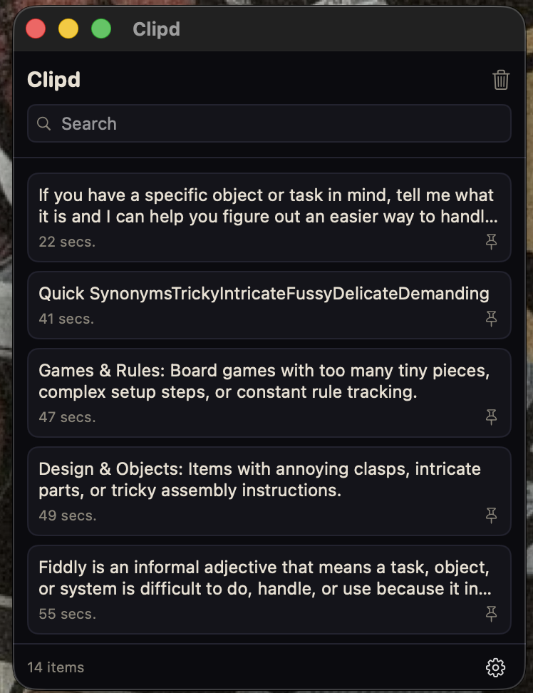

# Clipd

[](https://github.com/net-folade/clipd/actions/workflows/ci.yml)


A lightweight, local-only clipboard history manager for macOS. Swift + SwiftUI,
no third-party dependencies, MIT licensed.

| Menu bar | Dock window |
| :---: | :---: |
|  |  |

## Features

- Keeps your last 30 copied text snippets — or 10, 50, 100 or 200 (pinned items
  don't count against the cap)
- Click an item to copy it back to the clipboard
- Press **⌥⌘V** anywhere to open Clipd, ↑/↓ to pick, Return to copy and jump back
  to the app you were in, Esc to dismiss (the shortcut can be turned off in settings)
- Ignore specific apps so nothing copied while they're in front is recorded
- Optional launch at login
- Search, pin favorites, clear history (pinned items survive unless you say otherwise)
- Pause recording any time
- Midnight-black dark theme and beige light theme, or follow the system
- Lives in the menu bar and the Dock — or menu-bar-only via a toggle in settings

## Your data stays on your Mac

- **No networking code at all.** No `URLSession`, no analytics, no update checks.
- **No scary permissions.** Clipd never asks for Accessibility, Full Disk Access,
  or Screen Recording. Clicking an item copies it — you paste yourself with ⌘V.
- **Password managers are respected.** Payloads marked with the standard
  [nspasteboard.org](http://nspasteboard.org) concealed/transient/auto-generated
  types are never recorded. There's also a Pause toggle for manual credential handling.
- **Sandboxed.** Clipd runs in the macOS App Sandbox: it can't read or write
  your files outside its own container and has no network access of its own.
- **One small file.** History lives in
  `~/Library/Containers/com.folade.clipd/Data/Library/Application Support/Clipd/history.json`
  with owner-only (`0600`) permissions, capped at your chosen history size (30
  unpinned items by default). Delete the file and it's gone. Upgrading from
  1.0.x? The first time the sandboxed version runs, macOS moves your old
  `~/Library/Application Support/Clipd/` history and your settings into the
  container. The move is one-way (1.0.x won't find them afterwards), and it
  only happens when the container is first created — if history is missing,
  look in the old folder.
- **Not encrypted at rest.** FileVault is the real protection here. Note that
  `~/Library/Containers/` is included in Time Machine and most cloud
  backups, so a copied secret can outlive the history cap inside a backup.
- **Privacy policy:** see [PRIVACY.md](PRIVACY.md).
- **No third-party dependencies** — no supply-chain surface.

## Install (no building required)

Pick the zip that matches your Mac. Both need macOS 14 or newer and install
the same way.

| Your Mac | Download | Updates |
| --- | --- | --- |
| Apple Silicon (M1 and later) | `Clipd.app.zip` from the [latest release](https://github.com/net-folade/clipd/releases/latest) | Every release |
| Intel | `Clipd-intel.app.zip` from the newest `intel-v*` release on the [releases page](https://github.com/net-folade/clipd/releases) | Occasional |

Not sure which you have? **Apple menu → About This Mac**. A "Chip" line means
Apple Silicon; a "Processor" line means Intel.

1. Download the zip for your Mac and unzip it.
2. Drag `Clipd.app` into `/Applications`.
3. First launch only: macOS quarantines apps downloaded from the internet, and
   Clipd isn't notarized. Either right-click `Clipd.app` → **Open** → **Open**,
   or clear the quarantine flag in Terminal:

   ```sh
   xattr -d com.apple.quarantine /Applications/Clipd.app
   ```

After that it opens normally. Prefer to see exactly what you're running?
Build from source below — it's two commands.

## Build from source

Requires macOS 14+ and either Xcode or just the Command Line Tools
(`xcode-select --install`).

```sh
git clone https://github.com/net-folade/clipd.git
cd clipd
swift Scripts/make-icon.swift   # once — renders Assets/AppIcon.icns
Scripts/build-app.sh            # release build → Clipd.app (Apple Silicon, ad-hoc signed)
Scripts/build-app.sh x86_64     # same, for an Intel Mac
cp -R Clipd.app /Applications
```

Run the tests with `Scripts/test.sh` (a thin wrapper over `swift test` that adds
the framework search paths a CLT-only toolchain needs for Swift Testing).

### Gatekeeper note

Clipd is ad-hoc signed, not notarized (notarization requires a paid Apple
Developer account and isn't needed for personal use). On first launch,
right-click `Clipd.app` → **Open** → **Open** to get past Gatekeeper.

## Contributing

Contributions are welcome — bug fixes, features, docs, tests, all of it.

- **Found a bug?** Open an [issue](https://github.com/net-folade/clipd/issues)
  with your macOS version and what you did.
- **Have a fix or a feature?** Send a pull request. For anything sizeable, an
  issue first is appreciated so we can agree on the shape before you write it,
  but it isn't required.
- **Before you push:** run `Scripts/test.sh` and add a test for new behavior.
  Every PR runs `swift build` and `swift test` in CI.

Two things stay non-negotiable: no third-party dependencies, and no networking
code. Those are the point of the project. The "out of scope for v1" list below
is about what I didn't build yet, not about what I'd refuse.

## Out of scope for v1

Images/files, auto-paste, sync, encryption at rest.

## License

[MIT](LICENSE) © Folade
